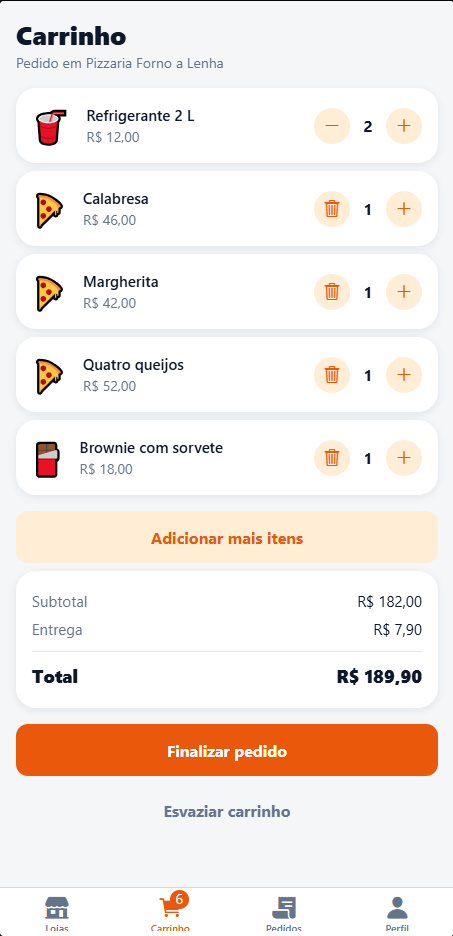
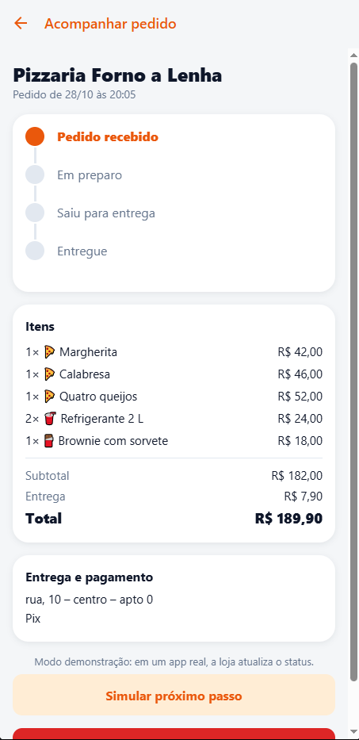
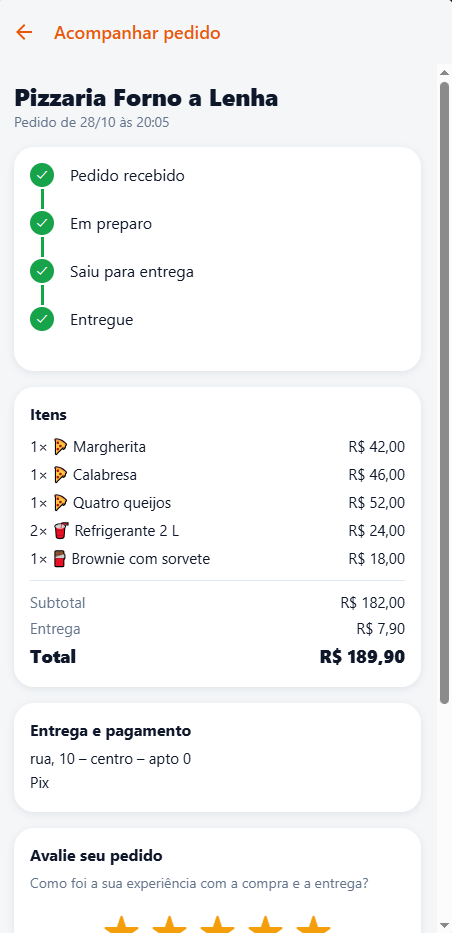
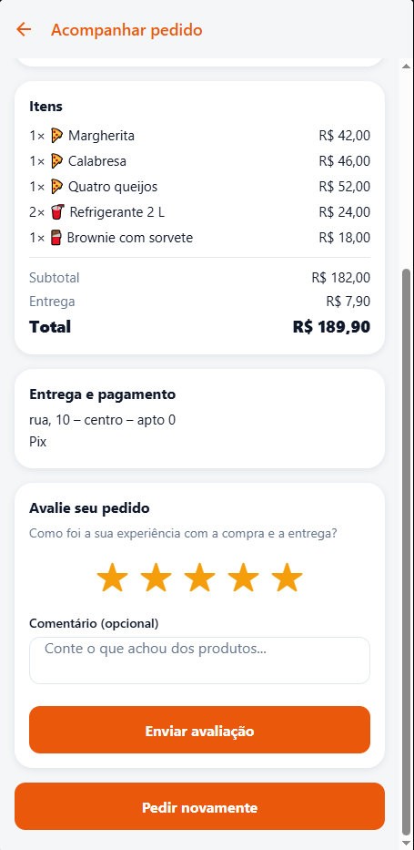

# MarketGo

Aplicativo mobile de compras com entrega desenvolvido em React Native e Expo: o usuário escolhe uma loja, navega pelo cardápio, monta o carrinho, finaliza o pedido com validação completa e acompanha cada etapa em tempo real até a entrega. Os pagamentos são simulados.

---

## Capturas de Tela

| Lojas e Catálogo | Carrinho de Compras | Acompanhamento (Em Andamento) |
| :---: | :---: | :---: |
|  |  |  |

| Pedido Entregue (Linha do Tempo) | Avaliação por Estrelas (Apêndice C) |
| :---: | :---: |
|  |  |

---

## Funcionalidades

- **Autenticação Segura:** Cadastro, login e sessão persistente gerenciados pelo Supabase Auth.
- **Catálogo Inteligente:** Lista de lojas com busca em tempo real, filtro rápido por categoria (chips) e indicador visual de loja aberta/fechada.
- **Cardápio e Detalhes:** Navegação de produtos por seção, visualização individual detalhada e controle de quantidade.
- **Carrinho Salvo no Aparelho:** Persistência local com AsyncStorage, regra de negócio de loja única e confirmação inteligente ao trocar de loja.
- **Checkout com Validação Rigorosa:** Formulário validado com Zod e React Hook Form, suportando Pix, Cartão e Dinheiro (com validação estrita de troco).
- **Segurança Transacional no Banco:** Pedido criado atomicamente via RPC (`create_order`) no PostgreSQL, garantindo cálculo de totais com preços autoritativos do servidor.
- **Acompanhamento em Tempo Real:** Linha do tempo visual do status do pedido com polling adaptativo e modo de demonstração.
- **Histórico e Reordenação:** Consulta de pedidos anteriores e botão "Pedir novamente" que reconstrói o carrinho validando itens disponíveis.
- **Avaliação de Pedido (Apêndice C):** Sistema de avaliação por estrelas (1 a 5 estrelas) com comentário opcional, protegido por RLS e permitido exclusivamente após a entrega do pedido.
- **Isolamento de Dados (RLS):** Row Level Security estrito no Postgres garantindo que nenhum usuário visualize ou altere pedidos alheios.

---

## Tecnologias

- **Mobile Framework:** [React Native](https://reactnative.dev/) com [Expo](https://expo.dev/) (SDK 52)
- **Navegação:** [Expo Router](https://docs.expo.dev/router/introduction/) (File-based routing)
- **Linguagem:** [TypeScript](https://www.typescriptlang.org/)
- **Backend as a Service:** [Supabase](https://supabase.com/) (Auth, PostgreSQL, Row Level Security, Funções PL/pgSQL)
- **Gerenciamento de Estado de Servidor:** [TanStack Query (React Query)](https://tanstack.com/query)
- **Formulários e Validação:** [React Hook Form](https://react-hook-form.com/) & [Zod](https://zod.dev/)
- **Armazenamento Local:** [@react-native-async-storage/async-storage](https://react-native-async-storage.github.io/async-storage/)
- **Testes Automatizados:** [Jest](https://jestjs.io/) (37 testes unitários do app) e [@electric-sql/pglite](https://pglite.electric-sql.com/) (14 testes de banco com Postgres em memória)
- **Integração Contínua (CI):** [GitHub Actions](https://github.com/features/actions)

---

## Como Executar

### Pré-requisitos
- Node.js 20+ ou 22+
- `pnpm` (gerenciador recomendado) ou `npm`
- Aplicativo **Expo Go** no celular ou emulador Android/iOS configurado

### 1. Clonar e Instalar Dependências
```bash
git clone https://github.com/joaoaugustoneto/MarketGo_React_Native.git
cd MarketGo_React_Native/marketgo
pnpm install
```

### 2. Configurar o Banco no Supabase
1. Crie um projeto no [Supabase](https://supabase.com).
2. Abra o **SQL Editor** do Supabase.
3. Execute o script `supabase/schema.sql` para criar tabelas, políticas RLS e funções RPC.
4. Execute o script `supabase/seed.sql` para carregar as lojas e produtos de exemplo.

### 3. Configurar Variáveis de Ambiente
Crie um arquivo `.env` dentro da pasta `marketgo/`:
```env
EXPO_PUBLIC_SUPABASE_URL=https://seu-projeto.supabase.co
EXPO_PUBLIC_SUPABASE_KEY=sua-chave-publica-anon
```
*(Certifique-se de que a URL base não tenha `/rest/v1/` no final).*

### 4. Iniciar o Aplicativo
```bash
pnpm expo start -c
```
Escaneie o QR Code exibido no terminal utilizando o aplicativo **Expo Go** no Android (ou a câmera no iOS).

---

## Segurança em Uma Linha

> O app **não possui permissão direta de escrita** nas tabelas `orders` e `order_items`: não existe política de `insert`, `update` ou `delete` aberta para o cliente. Toda escrita ocorre por funções transacionais seguras (`create_order`, `advance_order`, `cancel_order`) que validam regras de negócio, calculam totais com preços do banco e controlam a máquina de estados do status. Além disso, a tabela de avaliações (`order_reviews`) valida via RLS que apenas o dono do pedido pode avaliá-lo e somente se o pedido estiver com status `delivered`.

---

## Testes Automatizados (51 Testes)

| Comando | O que é testado | Cobertura |
| :--- | :--- | :--- |
| `pnpm test` | Executa a suíte completa | **51 testes** (App + Banco) |
| `pnpm run test:app` | Regras puras no Jest | 37 testes (Carrinho, Catálogo, Checkout, Pedidos e Dinheiro) |
| `pnpm run test:db` | Regras no Postgres via PGlite | 14 testes (RLS, Permissões, Preços no Servidor, Status e Avaliações) |
| `pnpm run typecheck` | Verificação estática de tipos | TypeScript sem erros (`tsc --noEmit`) |
| `pnpm run format` | Verificação e formatação | Prettier |

O teste de banco utiliza o **PGlite** (motor WebAssembly do Postgres real executado diretamente no Node), permitindo testar com fidelidade transações, RLS e roles (`anon`/`authenticated`) sem precisar de Docker.

---

## CI / Integração Contínua (GitHub Actions)

O repositório possui uma pipeline de Integração Contínua automatizada em [`.github/workflows/ci.yml`](file:///.github/workflows/ci.yml):
- Executa a cada `push` e `pull request` para a branch `main`.
- Instala dependências com `pnpm`.
- Valida tipagem TypeScript (`typecheck`).
- Confere regras de formatação (`prettier --check`).
- Executa todos os 51 testes automatizados (Jest e PGlite).

---

## Build para Android (APK Independente)

O projeto está configurado para gerar um executável Android (`.apk`) via Expo Application Services (EAS Build), permitindo instalação direta no smartphone sem depender do Expo Go:

```bash
# 1. Instalar o EAS CLI
pnpm add -g eas-cli

# 2. Entrar na conta Expo
eas login

# 3. Gerar o instalador APK (perfil preview)
cd marketgo
eas build --platform android --profile preview
```

---

## Estrutura de Arquivos

```
marketgo/
├── app/                      # Rotas e telas (Expo Router)
│   ├── (auth)/               # Fluxo de login e cadastro
│   ├── (app)/                # Fluxo autenticado
│   │   ├── (tabs)/           # Abas principais (Início, Pedidos, Carrinho, Perfil)
│   │   ├── store/[id].tsx    # Cardápio da loja
│   │   ├── product/[id].tsx  # Detalhes do produto
│   │   ├── checkout.tsx      # Finalização e validação de endereço/pagamento
│   │   └── order/[id].tsx    # Acompanhamento e avaliação do pedido
├── src/
│   ├── components/           # Componentes reutilizáveis (Card, StarRating, etc.)
│   ├── context/              # Contextos globais (AuthContext, CartContext)
│   ├── hooks/                # Queries e mutations (TanStack Query)
│   ├── schemas/              # Esquemas de validação Zod
│   ├── services/             # Comunicação com a API do Supabase
│   ├── theme/                # Cores, espaçamentos, tipografia e sombras
│   ├── types/                # Definições de tipos TypeScript
│   └── utils/                # Funções puras de regras de negócio
├── supabase/
│   ├── schema.sql            # Definição do banco, RLS e funções RPC
│   ├── seed.sql              # Dados iniciais para demonstração
│   └── tests/                # Testes de banco rodando no PGlite
├── docs/                     # Capturas de tela para documentação
├── .github/workflows/ci.yml  # Pipeline de CI no GitHub Actions
├── eas.json                  # Configurações de build do EAS
└── package.json
```

---

## Autor

Desenvolvido por **João Augusto Neto** no curso de Programação para Dispositivos Móveis (IESB).

- **GitHub:** [joaoaugustoneto](https://github.com/joaoaugustoneto)
- **Repositório:** [MarketGo_React_Native](https://github.com/joaoaugustoneto/MarketGo_React_Native)
